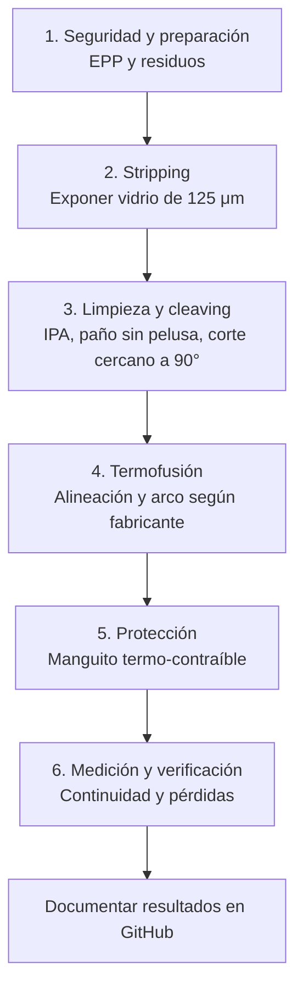
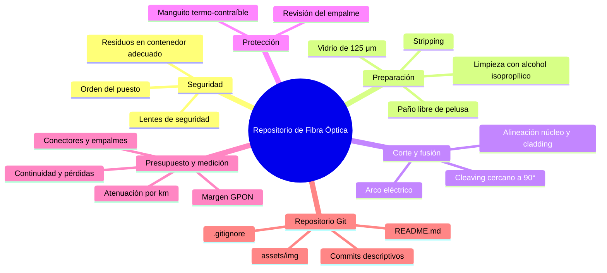

# Diagramas editables (Mermaid)

GitHub puede representar los siguientes bloques Mermaid directamente en archivos Markdown. Las imágenes SVG equivalentes están disponibles en `assets/img/`.

## Esquema de proceso

## Mapa mental

