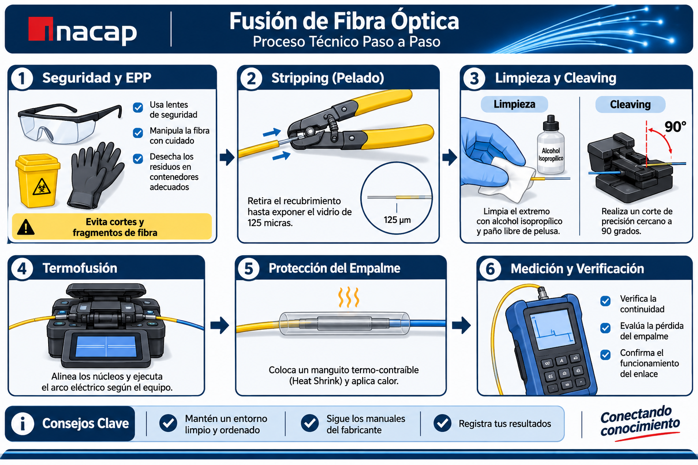
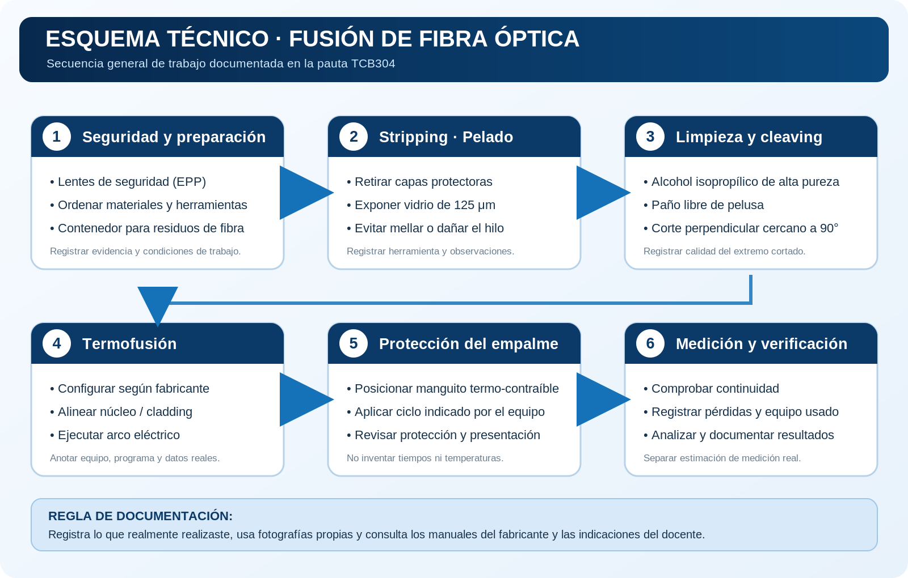
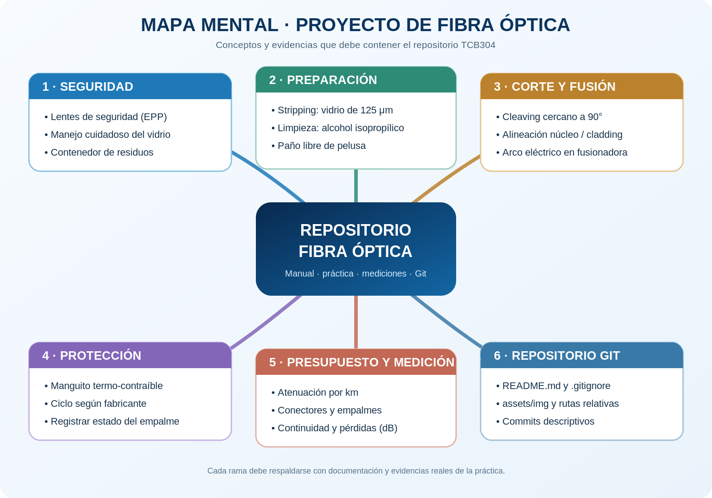

# Manual técnico: Fusión de Fibra Óptica

**INACAP · TCB304 – Infraestructura de Redes**  
**Unidad 2: Infraestructura de redes de fibra óptica**

> Este repositorio documenta el trabajo práctico de preparación, termofusión, protección, presupuesto óptico y verificación de un enlace de fibra óptica. Los campos marcados como **[Completar]** deben llenarse con los datos reales de la práctica. No se deben inventar mediciones, fotografías ni parámetros de los equipos.

---

## Identificación del proyecto

| Dato | Información |
|---|---|
| Estudiante | **[Cristobal gonzalez]** |
| Carrera | Ingeniería en Telecomunicaciones / Conectividad y Redes |
| Asignatura | Infraestructura de Redes (TCB304) |
| Sede | La Serena |
| Docente | [Daniel Ruz] |
| Fecha de práctica | [17-11-2026] |
| Enlace / muestra trabajada | [Clases] |

## 1. Introducción

La fibra óptica es un medio de transmisión que transporta información mediante señales luminosas a través de un filamento de vidrio. Para obtener un enlace confiable, los extremos deben prepararse cuidadosamente, limpiarse y cortarse con precisión antes de realizar el empalme por fusión. Después se protege el empalme y se comprueba la continuidad y la pérdida óptica.

Este manual registra las etapas solicitadas en la pauta de evaluación de TCB304: seguridad y manejo de materiales, stripping, limpieza, cleaving, termofusión, presupuesto óptico, mediciones y documentación mediante Git.

## 2. Objetivos

### Objetivo general

Documentar la preparación, fusión y verificación de un enlace de fibra óptica, aplicando las medidas de seguridad y registrando los parámetros técnicos y resultados obtenidos durante la práctica.

### Objetivos específicos

- Identificar las herramientas, materiales y elementos de protección utilizados.
- Describir el pelado, limpieza y corte de precisión de la fibra.
- Registrar la configuración aplicada en la fusionadora según el equipo y las indicaciones del docente.
- Documentar la protección del empalme y las mediciones de continuidad y pérdida.
- Calcular el presupuesto óptico con los valores reales o de referencia entregados para la actividad.
- Mantener un historial ordenado de cambios mediante Git.

## 3. Glosario técnico exprés

| Término | Definición |
|---|---|
| **Núcleo (Core)** | Región central de vidrio por donde se propaga principalmente la señal luminosa. |
| **Cladding** | Capa de vidrio que rodea al núcleo y, por su índice de refracción, ayuda a confinar la luz dentro de la fibra. |
| **Cleaving** | Corte de precisión del extremo de la fibra para obtener una cara limpia y aproximadamente perpendicular al eje. |
| **Atenuación** | Disminución de la potencia óptica durante la propagación; normalmente se expresa en dB o dB/km. |

## 4. Materiales y herramientas

Registra únicamente los elementos que efectivamente utilizaste en el taller.

| Material / herramienta | Uso dentro del procedimiento | Marca / modelo / observación |
|---|---|---|
| Lentes de seguridad | Protección ocular durante la práctica |  |
| Pinza peladora (stripper) | Retirar las capas protectoras de la fibra |  |
| Alcohol isopropílico de alta pureza | Limpieza del extremo de la fibra |  |
| Paños libres de pelusa | Limpieza sin dejar residuos |  |
| Cortadora de precisión (cleaver) | Preparar una cara de corte perpendicular |  |
| Fusionadora | Alinear y fusionar los extremos de fibra |  |
| Manguito termo-contraíble | Proteger mecánicamente el empalme |  |
| Contenedor para residuos de fibra | Depositar fragmentos de vidrio de forma segura |  |
| Instrumental de medición | Comprobar continuidad y/o pérdida óptica |  |

## 5. Seguridad y manejo de materiales

La pauta solicita evidenciar el uso de lentes de seguridad y la disposición de residuos de fibra en contenedores adecuados. También exige describir el manejo cuidadoso de los materiales.

- **EPP:** utilizar lentes de seguridad durante la preparación y manipulación de la fibra.
- **Fragmentos:** tratar los restos de fibra como residuos cortantes; no dejarlos sobre la mesa ni eliminarlos en papeleros comunes.
- **Disposición:** depositar los fragmentos en el contenedor destinado para residuos de fibra, según las indicaciones del taller.
- **Orden:** mantener identificadas las herramientas y despejada el área de trabajo.
- **Procedimientos del equipo:** respetar las instrucciones del docente y los manuales del fabricante.

> [!WARNING]
> Los fragmentos de fibra pueden ser muy pequeños y difíciles de visualizar. No manipules restos con las manos desnudas ni mires directamente hacia el extremo de una fibra conectada a una fuente óptica. Sigue siempre el procedimiento de seguridad del taller.

### Evidencia fotográfica requerida

- [ ] Fotografía propia donde se observe el uso de lentes de seguridad.
- [ ] Fotografía del contenedor adecuado para residuos de fibra.
- [ ] Fotografía de los materiales y herramientas dispuestos en el puesto de trabajo.

Agrega tus fotografías a `assets/img/evidencias/` y registra en `docs/registro-fotografico.md` qué muestra cada una.

## 6. Vista general del procedimiento

### Infografía de apoyo



*La infografía es material visual de apoyo. No reemplaza las instrucciones del docente, los manuales de los equipos ni las evidencias de tu ejecución real.*

### Esquema del proceso



### Mapa mental del proyecto



También se incluyen los archivos SVG equivalentes en `assets/img/` para conservar una versión vectorial editable.

## 7. Procedimiento técnico documentado

### 7.1 Stripping – Pelado de la fibra

**Objetivo:** retirar las capas protectoras necesarias para dejar expuesto el vidrio de la fibra sin dañarlo.

**Registro de la práctica:**

| Dato | Registro |
|---|---|
| Herramienta utilizada | [Marca / modelo] |
| Tipo de fibra, si se conoce |  |
| Diámetro de vidrio indicado en la pauta | **125 μm** |
| Estado observado del hilo |  |
| Observaciones |  |

**Resultado esperado:** fibra preparada y sin mellas visibles en el vidrio. La pauta solicita documentar la exposición del vidrio de 125 micras.

> [!WARNING]
> Evita dañar o mellar el hilo de vidrio. Realiza el procedimiento de acuerdo con el tipo de fibra, la herramienta disponible y las indicaciones del docente.

**Fotografía propia:** `assets/img/evidencias/stripping.jpg` (agregar cuando esté disponible).

### 7.2 Limpieza de precisión

**Objetivo:** retirar suciedad o residuos que puedan afectar la calidad del empalme y aumentar la atenuación.

**Elementos indicados en la pauta:** alcohol isopropílico de alta pureza y paños libres de pelusa.

| Dato | Registro |
|---|---|
| Producto utilizado | Elementos para Fusionar |
| Pureza indicada en el envase o ficha | Pura |
| Paño utilizado | Micro Fibra |
| Observación del extremo después de limpiar |  |

**Resultado esperado:** extremo limpio, sin residuos visibles ni fibras de paño.

> [!WARNING]
> Utiliza el producto conforme a su ficha de seguridad y evita volver a contaminar el extremo después de limpiarlo.

**Fotografía propia:** `assets/img/evidencias/limpieza-fibra.jpg` (agregar cuando esté disponible).

### 7.3 Cleaving – Corte de precisión

**Objetivo:** obtener una cara de corte lo más perpendicular posible al eje de la fibra.

La pauta solicita un ángulo cercano a **90°**.

| Dato | Registro |
|---|---|
| Cortadora utilizada (marca / modelo) |  |
| Ángulo objetivo indicado por la pauta | **Cercano a 90°** |
| Valor o evaluación obtenida, si el equipo lo informa |  |
| Estado del corte |  |
| Observaciones |  |

**Resultado esperado:** extremo de corte limpio y perpendicular, apto para el proceso de fusión según el criterio del equipo y del docente.

> [!WARNING]
> No inventes un valor de ángulo medido. Si el equipo no entrega una medición numérica, describe la inspección o el criterio de aceptación realmente utilizado.

**Fotografía propia:** `assets/img/evidencias/cleaving.jpg` (agregar cuando esté disponible).

### 7.4 Proceso de termofusión

**Objetivo:** unir los extremos preparados mediante una fusionadora por arco eléctrico.

La documentación debe evidenciar la configuración de la fusionadora, la alineación de núcleo/cladding y la ejecución del arco eléctrico. Los valores y programas dependen del tipo de fibra, del equipo y de sus manuales; la pauta no entrega valores universales de configuración.

| Dato | Registro real de la práctica |
|---|---|
| Marca y modelo de fusionadora |  |
| Tipo de fibra seleccionado |  |
| Programa / modo utilizado |  |
| Método de alineación indicado por el equipo | [] |
| Estimación de pérdida mostrada por la fusionadora (si aparece) | [] dB |
| Mensaje o resultado del equipo | [] |
| Observaciones del docente | [] |

**Resultado esperado:** empalme realizado por fusión, con registro del resultado que informa el equipo.

> [!WARNING]
> No copies configuraciones de otra fusionadora. Registra los parámetros realmente seleccionados y sigue el manual del fabricante y las instrucciones del docente.

**Fotografía propia:** `assets/img/evidencias/fusionadora.jpg` (agregar cuando esté disponible).

### 7.5 Protección del empalme

**Objetivo:** proteger mecánicamente el punto de unión utilizando el manguito termo-contraíble (heat shrink).

| Dato | Registro |
|---|---|
| Tipo de manguito utilizado | [Completar] |
| Equipo / compartimiento de calentamiento | [Completar] |
| Ciclo indicado por el fabricante | [Completar según el equipo] |
| Inspección visual final | [Completar] |
| Observaciones | [Completar] |

**Resultado esperado:** empalme cubierto y protegido, sin atribuir valores de temperatura o tiempo que no hayan sido registrados.

**Fotografía propia:** `assets/img/evidencias/termocontraible.jpg` (agregar cuando esté disponible).

### 7.6 Medición y verificación

**Objetivo:** registrar la continuidad y las pérdidas del enlace y analizar si el resultado cumple el criterio definido para la práctica.


**Importante:** una estimación que muestra la fusionadora para un empalme no es necesariamente lo mismo que una medición de pérdida de extremo a extremo del enlace. Identifica siempre qué equipo entregó cada valor y qué prueba se realizó.

**Fotografía propia:** `assets/img/evidencias/mediciones.jpg` (agregar cuando esté disponible).

## 8. Presupuesto óptico

El presupuesto óptico reúne las pérdidas previstas en el enlace. La pauta solicita considerar atenuación por kilómetro, conectores, empalmes y margen GPON. **La guía de evaluación no entrega valores numéricos para estos parámetros**, por lo que deben obtenerse de los datos de la práctica, fichas técnicas, manuales o instrucciones entregadas por el docente.


### 8.2 Fórmulas

**Pérdida por fibra:**

`A_fibra = L × α`

**Pérdida por conectores:**

`A_conectores = Nc × Ac`

**Pérdida por empalmes:**

`A_empalmes = Ne × Ae`

**Pérdida física estimada:**

`A_física = A_fibra + A_conectores + A_empalmes + A_otros`

**Estimación de diseño con margen (cuando el criterio del proyecto lo define como reserva adicional):**

`A_diseño = A_física + M`

Donde `L` es la longitud en km; `α` es la atenuación lineal en dB/km; `Nc` y `Ne` son cantidades; `Ac` y `Ae` son pérdidas unitarias; `M` es el margen/reserva adoptado según el criterio GPON entregado para la actividad.

> [!NOTE]
> Mantén separados la pérdida física calculada y el margen de diseño. No presentes el margen como una pérdida medida. Confirma con el docente qué valor y criterio de margen GPON debe utilizarse para esta evaluación.

### 8.3 Resultado del cálculo

| Resultado | Valor |
|---|---:|
| Pérdida por fibra | [Completar] dB |
| Pérdida por conectores | [Completar] dB |
| Pérdida por empalmes | [Completar] dB |
| Otras pérdidas | [Completar] dB |
| **Pérdida física estimada** | **[Calcular] dB** |
| Margen / reserva GPON | [Completar] dB |
| **Total de diseño con margen** | **[Calcular, si corresponde] dB** |

### 8.4 Análisis

[Explica qué componente aporta la mayor pérdida, compara el cálculo con la medición disponible y señala posibles diferencias. Si no hay medición real, indícalo expresamente.]

## 9. Registro de resultados de la práctica

| Etapa | Resultado observado | Evidencia / archivo | Observaciones |
|---|---|---|---|
| Seguridad y EPP | [Completar] | [Nombre de fotografía] | [Completar] |
| Stripping | [Completar] | [Nombre de fotografía] | [Completar] |
| Limpieza | [Completar] | [Nombre de fotografía] | [Completar] |
| Cleaving | [Completar] | [Nombre de fotografía] | [Completar] |
| Termofusión | [Completar] | [Nombre de fotografía] | [Completar] |
| Protección del empalme | [Completar] | [Nombre de fotografía] | [Completar] |
| Medición / verificación | [Completar] | [Nombre de fotografía] | [Completar] |

## 10. Conclusiones

[Redacta con tus propias palabras qué etapas realizaste, qué aprendiste, cuál fue el resultado obtenido y qué aspectos mejorarías. Relaciona tus conclusiones con las evidencias y mediciones reales. No declares que el enlace quedó conforme si no se verificó.]

## 11. Control de versiones con Git

El historial debe mostrar avances graduales y commits descriptivos. Desde la carpeta del proyecto, puedes utilizar:

```bash
# Inicializar el repositorio local
git init

# Revisar los archivos pendientes
git status

# Agregar los archivos al área de preparación
git add .

# Crear el primer registro
git commit -m "Initial commit: estructura del repositorio"

# Revisar el historial
git log --oneline
```

Después de crear un repositorio vacío en GitHub, vincúlalo usando la URL real de tu repositorio:

```bash
git branch -M main
git remote add origin https://github.com/TU-USUARIO/TU-REPOSITORIO.git
git push -u origin main
```

Reemplaza `TU-USUARIO` y `TU-REPOSITORIO` por tus datos. No compartas contraseñas ni tokens.

### Ejemplos de commits para el avance

```bash
git add README.md
git commit -m "Docs: creación del manual técnico"

git add assets/img/
git commit -m "Assets: incorporación de esquemas e infografía"

git add docs/
git commit -m "Docs: registro de evidencias y mediciones"

git add .
git commit -m "Docs: actualización del presupuesto óptico y conclusiones"
```

## 12. Lista de verificación de la pauta

Antes de entregar, revisa los siete criterios de la escala de apreciación. Marca el estado y comprueba que exista evidencia en el repositorio.

| N.º | Criterio de evaluación | Qué debes comprobar | Estado |
|---:|---|---|---|
| 1 | Estructura y archivos del repositorio | `README.md`, `assets/img/`, rutas relativas y `.gitignore` | [ ] |
| 2 | Calidad del manual técnico | Glosario de 4 términos, pasos numerados, Markdown y advertencias | [ ] |
| 3 | Historial y buenas prácticas Git | Commits descriptivos y frecuentes que reflejen avances | [ ] |
| 4 | Presupuesto óptico | Atenuación por km, conectores, empalmes y margen GPON documentados | [ ] |
| 5 | Seguridad y preparación | EPP, disposición de residuos, stripping de 125 μm y limpieza con alcohol isopropílico | [ ] |
| 6 | Ejecución de fusión | Corte cercano a 90°, alineación por fusionadora y protector termo-contraíble | [ ] |
| 7 | Medición y verificación | Pérdidas estimadas/medidas identificadas, continuidad y análisis | [ ] |

**Escala de la pauta:** 4 = Sobresaliente · 3 = Bueno · 2 = Suficiente · 1 = Insuficiente.  
**Puntaje máximo:** 28 puntos.

| Criterio | Puntaje autoevaluado (1–4) | Evidencia o mejora pendiente |
|---|---:|---|
| 1. Estructura | [ ] | [Completar] |
| 2. Manual técnico | [ ] | [Completar] |
| 3. Git | [ ] | [Completar] |
| 4. Presupuesto óptico | [ ] | [Completar] |
| 5. Seguridad y preparación | [ ] | [Completar] |
| 6. Ejecución de fusión | [ ] | [Completar] |
| 7. Medición y verificación | [ ] | [Completar] |
| **Total** | **[ ] / 28** | |

## 13. Referencias y fuentes de datos

- INACAP, **Pauta de Evaluación Sumativa: Implementación de Red y Repositorio Git**, asignatura TCB304, Unidad 2: Infraestructura de redes de fibra óptica.
- Manual de usuario de la fusionadora utilizada: [fabricante, modelo, versión y enlace o documento].
- Manual de la cortadora de precisión utilizada: [fabricante, modelo, versión y enlace o documento].
- Ficha técnica del cable o fibra utilizada: [fabricante, modelo y documento].
- Parámetros de conectores, empalmes y margen GPON entregados por el docente o por la especificación del enlace: [identificar fuente].

---

## Estructura del repositorio

```text
repositorio-fibra-optica/
├── README.md
├── .gitignore
├── assets/
│   └── img/
│       ├── infografia-fusion-fibra-optica.png
│       ├── esquema-proceso-fusion.png
│       ├── esquema-proceso-fusion.svg
│       ├── mapa-mental-fibra-optica.png
│       ├── mapa-mental-fibra-optica.svg
│       └── evidencias/
│           └── README.md
└── docs/
    ├── diagramas-editables.md
    ├── registro-fotografico.md
    └── plantilla-mediciones.csv
```
